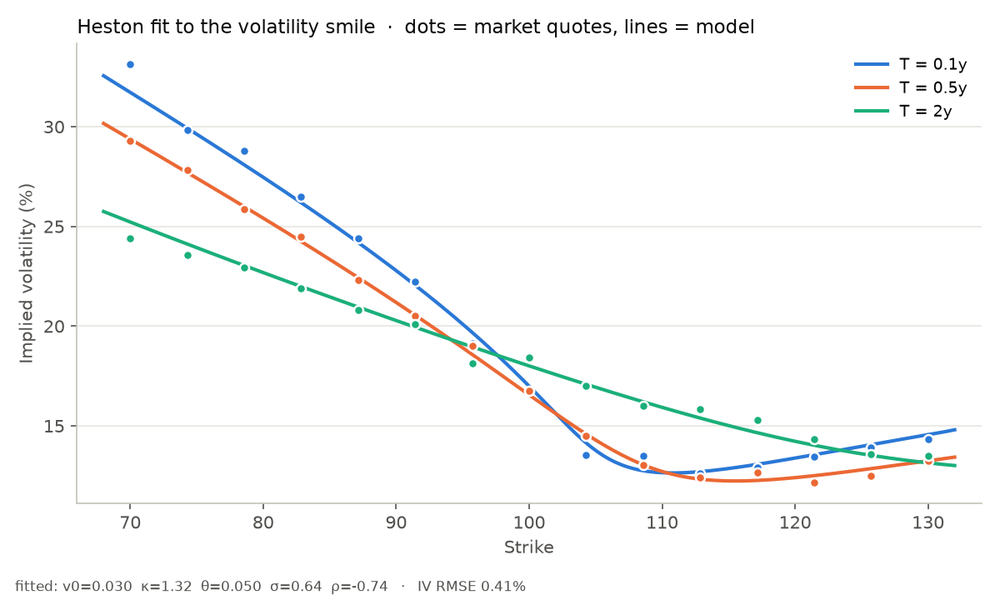

# volsmith 🔨📈

**ابزار دقیق قیمت‌گذاری اختیار معامله (آپشن)، محاسبه‌ی حساسیت‌ها (Greeks)، نوسان ضمنی و کالیبراسیون لبخند نوسان با مدل هستون — در پایتون**

*A rigorous Python toolkit for option pricing, Greeks, implied volatility and Heston smile calibration.*



---

## چه مسئله‌ای را حل می‌کند؟

قیمت‌گذاری مشتقات مالی یکی از مسائل محوری ریاضیات مالی است. هر بانک، صندوق یا
معامله‌گر آپشن باید هر روز به این سؤال‌ها جواب بدهد:

| سؤال | ماژول | روش |
|---|---|---|
| قیمت منصفانه‌ی یک آپشن اروپایی چقدر است و ریسکش چیست؟ | `black_scholes` | فرمول بسته‌ی بلک–شولز–مرتون + ۷ Greek تحلیلی |
| بازار چه نوسانی را «قیمت‌گذاری» کرده است؟ | `implied_vol` | نیوتن محافظت‌شده در براکت + حدس اولیه‌ی کورادو–میلر + بازگشت به برنت |
| آپشن آمریکایی (قابل اعمال زودهنگام) چقدر می‌ارزد؟ | `binomial` | درخت CRR با هموارسازی بلک–شولز و برون‌یابی ریچاردسون (BBSR) |
| آپشن آسیایی (بدون فرمول بسته) چقدر می‌ارزد؟ | `monte_carlo` | مونت‌کارلو با متغیرهای متقارن + متغیر کنترلی هندسی (کاهش واریانس ~۵۰۰ برابر) |
| چرا نوسان ضمنی برای هر قیمت اعمال فرق دارد (لبخند نوسان)؟ | `heston` | مدل نوسان تصادفی هستون، فرمول فوریه‌ی لوئیس، کالیبراسیون حداقل مربعات |

مدل بلک–شولز فرض می‌کند نوسان ثابت است، اما در بازار واقعی نوسان ضمنی برای
قیمت‌های اعمال مختلف متفاوت است («لبخند» یا «چولگی» نوسان). مدل هستون نوسان را
یک فرایند تصادفیِ بازگشت‌به‌میانگین و همبسته با قیمت سهم در نظر می‌گیرد:

```
dS = (r − q) S dt + √v S dW₁
dv = κ(θ − v) dt + σ √v dW₂        corr(dW₁, dW₂) = ρ
```

`volsmith` این مدل را در کسری از ثانیه به داده‌های بازار کالیبره می‌کند.

## نصب و اجرا

```bash
cd volsmith
pip install -e '.[dev,plot]'
pytest                       # 165 تست
```

### خط فرمان

```bash
volsmith price -S 100 -K 100 -T 1 -r 0.05 -v 0.2 --put   # همه‌ی موتورها + Greeks
volsmith iv    -S 100 -K 100 -T 1 -r 0.05 -p 10.45       # نوسان ضمنی
volsmith asian -S 100 -K 100 -T 1 -r 0.05 -v 0.2         # آپشن آسیایی
volsmith smile --rho -0.7 --sigma 0.6                    # لبخند نوسان هستون
volsmith calibrate                                       # کالیبراسیون روی بازار مصنوعی نویزی
```

نمونه خروجی:

```
 European put  S=100  K=100  T=1y  r=5.00%  q=0.00%  σ=20.00%

  Black–Scholes             5.573526
  Binomial (CRR, 2000)      5.573526
  Monte Carlo (400,000)     5.562704  95% CI [5.5384, 5.5870]
  American (CRR, 2000)      6.090397  early-exercise premium 0.516871

 Greeks
  Δ delta                   -0.363169
  Γ gamma                   +0.018762
  ν vega  (per 1 vol pt)    +0.375240
  Θ theta (per day)         -0.004542
  ...
```

### به‌عنوان کتابخانه

```python
import numpy as np
from volsmith import (bs_price, bs_greeks, implied_vol, crr_price,
                      mc_asian_arithmetic, HestonParams, heston_price, calibrate_heston)

bs_price(100, 105, 0.5, 0.03, 0.2, kind="call")                 # 4.1783
bs_greeks(100, 105, 0.5, 0.03, 0.2).delta                         # 0.4332
implied_vol(4.0, 100, 105, 0.5, 0.03)                             # برداری هم کار می‌کند
crr_price(36, 40, 1, 0.06, 0.2, kind="put", american=True)        # 4.4867
mc_asian_arithmetic(100, 100, 1, 0.05, 0.2).ci95                  # فاصله‌ی اطمینان ۹۵٪

p = HestonParams(v0=0.04, kappa=1.5, theta=0.04, sigma=0.6, rho=-0.7)
K = np.linspace(80, 120, 9)
heston_price(100, K, 0.5, 0.03, p)                                # کل یک ردیف قیمت اعمال
res = calibrate_heston(S, strikes, maturities, market_prices, r)  # res.params, res.rmse_iv
```

`examples/smile_calibration.py` تصویر بالای همین صفحه را می‌سازد.

## چرا به آن اعتماد کنیم؟ (صحت‌سنجی)

هر موتور با یک روش **مستقل** دیگر مقایسه می‌شود:

- **Greeks** در برابر تفاضل محدود مرکزی؛ برابری پوت–کال با دقت ‎1e-12‎؛ مثال کتاب Hull.
- **نوسان ضمنی**: رفت‌وبرگشت روی شبکه‌ی ۱۶۸ حالتی (سررسید ۱ روز تا ۵ سال، نوسان ۳٪ تا ۲۵۰٪، عمیقاً درون/بیرون پول؛ حالت‌هایی که ارزش زمانی‌شان زیر دقت ماشین است کنار گذاشته می‌شوند) و رد قیمت‌های خلاف آربیتراژ.
- **درخت دوجمله‌ای**: همگرایی به بلک–شولز (خطا < ‎5e-5‎)، مسئله‌ی معروف پوت آمریکایی لانگ‌استاف–شوارتز (4.48667)، و قضیه‌ی مرتون (کال آمریکایی بدون سود = اروپایی).
- **مونت‌کارلو**: قیمت درون فاصله‌ی اطمینان، فرمول بسته‌ی آسیایی هندسی، نامساوی AM–GM.
- **هستون**: مقایسه با فرمول دو‌احتمالی اصلی هستون (۱۹۹۳) با انتگرال‌گیری تطبیقی SciPy در پارامترهای افراطی (σ=3، ρ=−0.99، سررسید یک هفته تا ده سال) با خطای < ‎1e-8‎؛ مقایسه با شبیه‌سازی اویلر؛ حد بلک–شولز؛ و بازیابی دقیق پارامترها در کالیبراسیون.

## نکات فنی جالب

- **تله‌ی کوچک هستون** (Albrecher et al. 2007): شکل پایدار تابع مشخصه که از پرش شاخه‌ی لگاریتم مختلط جلوگیری می‌کند.
- **فرمول لوئیس** (2001): تابع مشخصه روی خط `Im u = −½` ارزیابی می‌شود و ضریب `1/(u²+¼)` انتگرال‌ده را هموار و سریع‌میرا می‌کند. پنل‌های گاوس–لژاندر نزدیک صفر ریزتر می‌شوند (قطب‌های `±i/2`) و بازه‌ی انتگرال از روی میرایی `|φ|` تعیین می‌شود.
- **کالیبراسیون وزن‌دار با وگا**: خطای قیمت تقسیم بر وگا ≈ خطای نوسان ضمنی؛ پس آپشن‌های ارزان بال‌ها هم به اندازه‌ی آپشن‌های ATM اهمیت می‌گیرند.
- **نوسان ضمنی روی سمت OTM**: قیمت‌ها با برابری پوت–کال به سمت خارج از پول برده می‌شوند که از نظر عددی خوش‌رفتار است.
- **BBSR**: حذف رفتار دندانه‌اره‌ای همگرایی درخت دوجمله‌ای.

## ساختار

```
volsmith/
├── src/volsmith/
│   ├── black_scholes.py   قیمت و Greeks بسته
│   ├── implied_vol.py     وارون‌سازی مقاوم
│   ├── binomial.py        درخت CRR / BBSR (اروپایی و آمریکایی)
│   ├── monte_carlo.py     مونت‌کارلو با کاهش واریانس (اروپایی و آسیایی)
│   ├── heston.py          قیمت‌گذاری فوریه و کالیبراسیون هستون
│   └── cli.py             رابط خط فرمان
├── tests/                 ۱۶۵ تست
├── examples/              نمودار کالیبراسیون لبخند
└── docs/
```

## منابع

- Black & Scholes (1973); Merton (1973)
- Cox, Ross & Rubinstein (1979); Broadie & Detemple (1996)
- Heston (1993); Lewis (2001); Albrecher, Mayer, Schoutens & Tistaert (2007)
- Kemna & Vorst (1990) — geometric Asian control variate
- Corrado & Miller (1996) — implied-volatility approximation
- Longstaff & Schwartz (2001)

MIT License.
